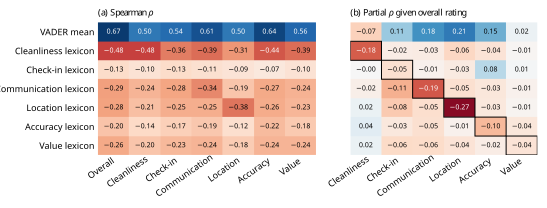
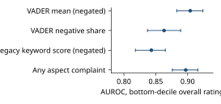

# Do Review Texts Track Star Sub-Scores? Lexicon Sentiment and Aspect Complaints in San Francisco Airbnb Reviews

## Abstract

Guest reviews on Airbnb come with free text and with star sub-scores (cleanliness, check-in, communication, location, accuracy, value). We ask how much of the listing-level star ratings can be recovered from the text with transparent, unsupervised signals, and whether aspect-specific complaint lexicons track their own sub-score rather than overall satisfaction. On the Inside Airbnb San Francisco snapshot of 2026-09-14 (397,628 English reviews; 2,755 listings with at least 20 of them), the mean VADER sentiment of a listing's reviews has a Spearman correlation of 0.67 with its overall rating and separates the bottom decile of listings with AUROC 0.904. After partialling out the overall rating, five of six aspect lexicons correlate most negatively with their matching sub-score, the clearest being location (partial ρ = −0.27), communication (−0.19) and cleanliness (−0.18). The keyword scorer of the first version of this repository is weaker (AUROC 0.843) and has a strong length bias. Limitations: one city, hand-written lexicons with low recall, and text and stars written by the same guests.

## 1. Problem

For each listing, Airbnb publishes the average star rating overall and per aspect, alongside every review text. Text-derived signals are useful only if they measure something the stars also measure. We test two properties:

1. **Convergent validity.** Does listing-level text sentiment rank listings like their overall rating?
2. **Discriminant validity.** Does a lexicon written for one aspect (for example cleanliness complaints) carry information about its own sub-score beyond the overall rating?

## 2. Data

[Inside Airbnb](https://insideairbnb.com/get-the-data/), San Francisco, snapshot 2026-09-14: `reviews.csv.gz` (452,048 non-empty reviews, 2009 to 2026) and `listings.csv.gz` (7,405 listings). Reviewer names and ids are never loaded (`usecols`), raw files stay in the git-ignored `data/` folder, and no review text is quoted in this repository. Reviews are kept if they are in English, by a function-word heuristic (`reviewtext.data.is_english`): 397,628 reviews (88%). A listing enters the analysis if it has at least 20 English reviews and all seven sub-scores: 2,755 listings, 378,377 reviews, median 81 reviews per listing.

## 3. Method

**Review-level signals.**
- *VADER* compound sentiment (Hutto and Gilbert, ICWSM 2014), in [−1, 1].
- *Aspect complaint lexicons*: one regular expression per sub-score, matched on word boundaries (`src/reviewtext/scoring.py`), for example *dirty, stained, mold, smell* for cleanliness, or *unsafe, sketchy, break-in* for location. A review is flagged if it matches.
- *Legacy keyword score*: the scorer of the first version of this repository, kept verbatim: substring counts of 17 positive and 16 negative words, divided by the number of words.

**Listing-level metrics.** Mean VADER, share of reviews with VADER < −0.05, mean legacy score, and the share of reviews flagged by each lexicon (and by any lexicon).

**Evaluation.** Spearman correlation with each sub-score; partial Spearman correlation given the overall rating (ranks residualised on the rank of the overall rating); AUROC for detecting listings in the bottom decile of overall rating (≤ 4.63, 285 listings). Confidence intervals: 1,000 bootstrap resamples of listings.

## 4. Results

<p align="center"></p>

*Figure 1. (a) Spearman correlation between listing-level text metrics and star scores. (b) Partial correlation given the overall rating; boxes mark each lexicon's own sub-score.*

**Sentiment tracks overall rating.** Mean VADER correlates with every sub-score (ρ = 0.50 to 0.67), most strongly with the overall rating. All lexicons correlate negatively with all sub-scores (Fig. 1a): sub-scores are themselves highly correlated, so raw correlations cannot show aspect specificity.

**Lexicons are aspect-specific after controlling for the overall rating.** In Fig. 1b, the most negative entry of each row is the lexicon's own sub-score for cleanliness, check-in, communication, location and accuracy. The value lexicon is the exception. Partial correlations with the own sub-score and 95% bootstrap intervals:

| Lexicon | Reviews flagged | Partial ρ, own sub-score | 95% CI |
|---|---|---|---|
| Location | 0.75% | −0.274 | [−0.313, −0.235] |
| Communication | 0.13% | −0.187 | [−0.214, −0.159] |
| Cleanliness | 1.49% | −0.181 | [−0.220, −0.143] |
| Accuracy | 0.07% | −0.097 | [−0.131, −0.065] |
| Check-in | 0.18% | −0.049 | [−0.083, −0.014] |
| Value | 0.19% | −0.041 | [−0.072, −0.010] |

*Table 1. From `results/partial_own_subscore_ci.csv` and `results/audit.json`.*

<p align="center"></p>

*Figure 2. AUROC for detecting bottom-decile listings by overall rating, with 95% bootstrap intervals.*

**Detecting low-rated listings.** Mean VADER reaches AUROC 0.904 [0.883, 0.924] and the share of reviews flagged by any complaint lexicon 0.897 [0.876, 0.916]. The legacy keyword score reaches 0.843 [0.818, 0.865].

**Audit of the first version.** The first version of this repository reported "insights" from the legacy scorer on 1.5 million California reviews. Those numbers depend on a merged multi-city file that is not available and were not re-verified. On this corpus, two defects of that method are measurable (`results/audit.json`). Its air-conditioning rule matches the substring `ac`, which occurs in words such as *place* and *back*, and flags 71.2% of reviews against 0.74% with a word-boundary rule. Its score is divided by review length, so it falls as reviews get longer (Spearman ρ = −0.54 with word count), while VADER rises with length (ρ = +0.64). Both length dependences confound comparisons between listings whose guests write differently.

## 5. Limitations

- One city and one snapshot. Sub-scores are lifetime averages published by Airbnb and are heavily concentrated near 5 (median overall rating 4.89).
- Text and stars come from the same guests at the same time, so this measures agreement between two channels of one judgement, not prediction of future ratings.
- Lexicons are hand-written and have low recall (0.07% to 1.5% of reviews flagged); negation is not handled (*not dirty* is flagged). A supervised aspect classifier or an instruction-tuned model would likely raise recall; neither is evaluated here.
- The language filter is heuristic; short or mixed-language reviews are dropped.
- VADER grows with review length; no length adjustment is applied to the listing means.

## Reproducibility

Python 3.12. The raw files are about 55 MB; scoring takes about 1.5 minutes on a laptop.

```sh
make env        # .venv with pinned requirements
make data       # download the Inside Airbnb snapshot to data/raw/ (git-ignored)
make analysis   # results/*.csv, results/*.json
make figures    # figures/*.svg
make test
```

| Path | Content |
|---|---|
| `src/reviewtext/data.py` | Download, cleaning, language filter (reviewer columns are never read) |
| `src/reviewtext/scoring.py` | VADER, aspect lexicons, legacy scorer |
| `src/reviewtext/analysis.py` | Listing aggregation, correlations, AUROC, bootstrap |
| `src/reviewtext/figures.py` | Figures |

Code released under the MIT license. Inside Airbnb data are published under CC BY 4.0; review texts are written by Airbnb guests and are not redistributed here.
